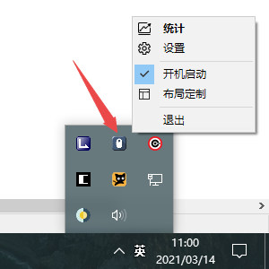
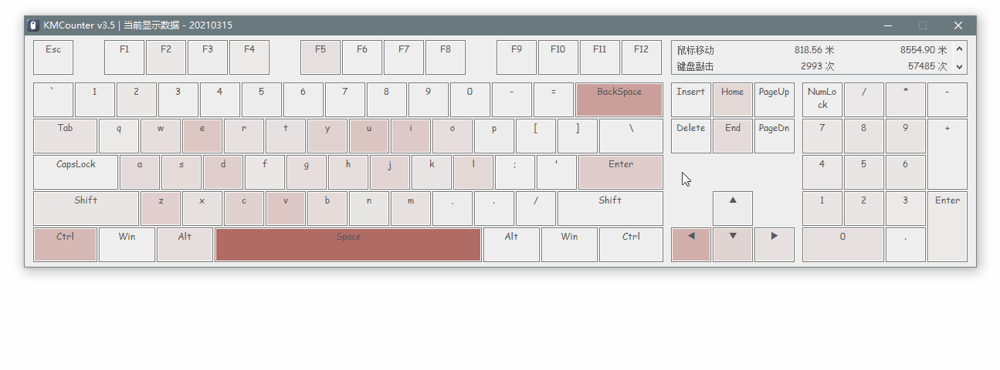
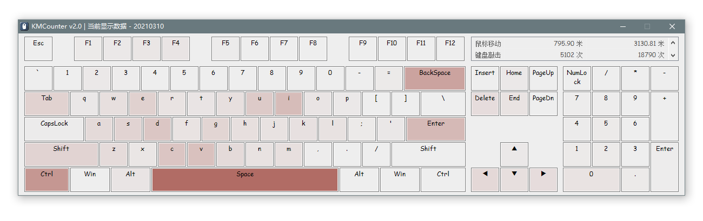
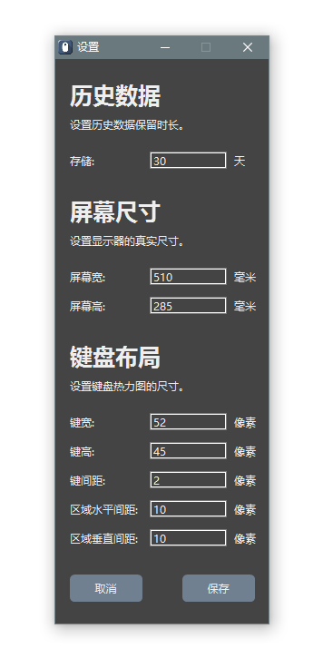

# KMCounter  
Use heatmap to show mouse and keyboard usage.  
使用热力图显示鼠标与键盘使用情况的工具。  

## Usage (用法)  
* After running, KMCounter will stay in the tray menu for statistics, click the tray icon to view the results when needed.  
* 运行后，KMCounter 将常驻托盘菜单进行统计，需要时点击托盘图标查看结果。  
  

* On the GUI of statistics, PageUp and PageDown or Up and Down or Mouse Wheel can view the historical statistics.  
* 在统计界面下，使用 翻页键 或 上下键 或 鼠标滚轮 可以查看历史结果。  
  

## Features (特性)  
> Multi-Language  
> Mouse      Info  
> Keyboard   Info  
> Single Key Info  
> History    Info  

> 支持查看鼠标信息。  
> 支持查看键盘信息。  
> 支持查看单键信息。  
> 支持查看历史信息。  
> 支持设置历史时长。  
> 支持设置屏幕尺寸。  
> 支持设置键盘布局。  
> 支持设置开机启动。  
> 支持区分真实模拟。  
> 支持高分辨率屏幕。  
> 支持低分辨率屏幕。  
> 更准确的统计方法。  
> 更完善的数据管理。  
> 键盘布局总是对齐。  
> 默认使用莫兰迪色。  
> 不想用了直接删除。  
> 不写系统不留垃圾。  

## Note (注意)  
* KMCounter uses the hook to statistics mouse and keyboard info, so antivirus may be a false alarm risk, just add to the trust list.  
* KMCounter 使用钩子统计键鼠使用情况，所以杀软可能会误报风险，加白名单即可。  

## Download (下载)  
* ver 3.7  
[Github Releases](https://github.com/telppa/KMCounter/releases)  
[蓝奏云](https://ahk.lanzoux.com/iK6zunucjqf)  

## History and totals (历史记录与总计)

The source version preserves saved daily records when browsing history or changing
the history display range. `0` shows all saved dates; a positive number limits the
visible range to today and that many preceding calendar days. Missing dates are
skipped. This setting no longer automatically deletes old records.

源码版本在查看历史或修改显示范围时保留已保存的每日记录。`0` 显示全部记录；
正整数显示今天及此前指定天数的记录，跳过没有数据的日期。该设置不再自动删除旧记录。

At startup, each cumulative counter uses the larger of its saved lifetime value
and the sum of the available daily records. This repairs undercounts that can be
reconstructed from retained history, without lowering lifetime totals when older
daily records are missing. Reading another day does not reset unsaved counters.
Records already deleted by an earlier version cannot be recovered this way.

启动时，每项总计取「已保存总计」与「现有每日记录之和」中较大的值，修复可从历史记录
还原的偏小总计，同时保留历史不完整时较高的累计值。查看其他日期不会重置尚未保存的
累计数据；此前已被删除的记录无法通过此方式恢复。

Back up `KMCounter.ini` before changing versions. The new display setting is stored
as `[history] view_days`; existing `storage` values are used on first migration.
Values outside `0..36500` fall back to show-all. Saving writes the legacy `storage`
field as `36500` so older versions do not interpret show-all as zero-day retention.
An older version still applies its own deletion policy; keep the backup when
rolling back. The new behavior applies to the source build, not an older release
executable downloaded from the links above.

换版本前请备份 `KMCounter.ini`。新显示范围保存为 `[history] view_days`，首次迁移时
读取旧 `storage` 值；超出 `0..36500` 的值按显示全部处理。保存时将旧 `storage` 写为
`36500`，避免旧版把「全部」当成零天保留期。旧版仍有自己的删除逻辑，回退时请保留备份。
此行为适用于源码构建，以上旧版发布包不会因此自动改变。

## Persistence regression tests (数据回归测试)

With AutoHotkey v1.1 (tested on Unicode 32-bit v1.1.33.06):

```text
AutoHotkeyU32.exe /ErrorStdOut=UTF-8 tests\CounterStore.tests.ahk
```

Optionally append an existing output directory as the first script argument. The
test creates a uniquely named subdirectory containing synthetic INI fixtures and
prints its results to stdout. It exits with `0` on success and `1` on failure.
It loads the production persistence module without starting KMCounter, installing
input hooks, displaying a GUI, or reading the user's real INI. The fixtures remain
available for inspection. No GUI libraries are required for these tests.

可在命令末尾指定一个已存在的输出目录。测试只在唯一命名的子目录中读写虚构记录，
通过标准输出报告结果；成功返回 `0`，失败返回 `1`。测试直接调用数据处理模块，
不会启动 KMCounter、安装输入钩子、显示界面或读取用户的真实 INI，也不需要界面库。
测试完成后保留虚构数据以供检查。

## Screenshots (截图)  
  
  
  
  

## 4 ways to customize your own keyboard layout (4种方法定制键盘布局)  
1. Modify the LoadControlList() in the code.  
   修改 LoadControlList() 相关代码。  

2. Have more than a thousand people with the same needs.  
   有1000人以上具有相同需求。  

3. I have the same keyboard.  
   我有一个同样的键盘。  

4. Donate 100RMB or more.  
   捐赠 100RMB 以上。  

## Thanks (感谢)  
[fwt](https://www.autoahk.com/archives/35133)  
[SKAN](https://www.autohotkey.com/boards/viewtopic.php?f=6&t=76881)  
[just me](https://github.com/AHK-just-me)  
[robodesign](https://github.com/marius-sucan)  
